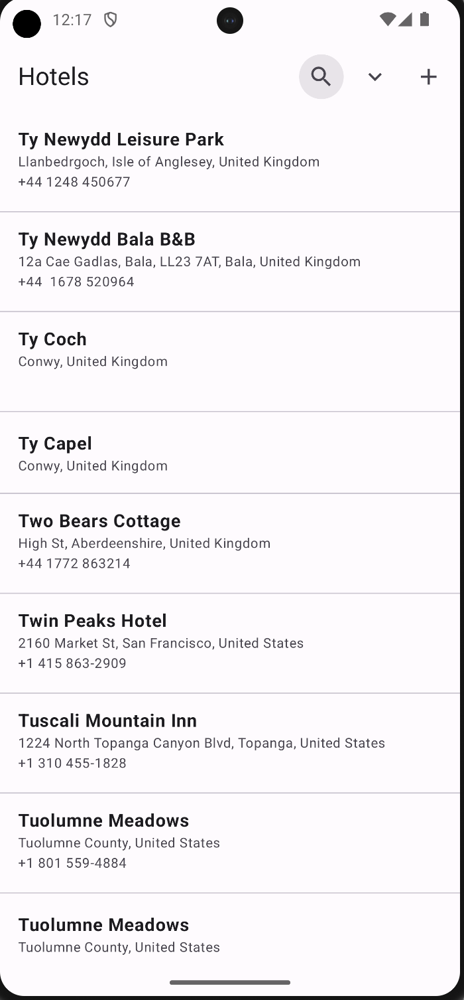
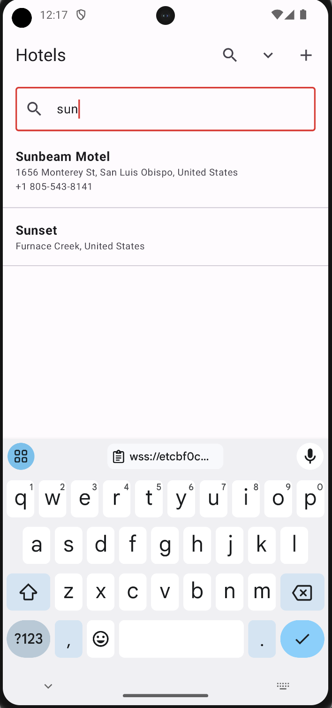
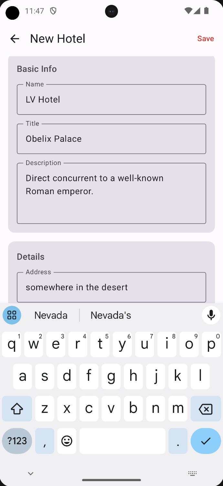

# Hotel Management Quick Start App using Couchbase Lite Android SDK + Jetpack Compose + Capella App Services

> **Note:** Please refer to the [global README.md](../README.md) for the Introduction and Capella Setup instructions before proceeding.

## App Overview
This Android sample app demonstrates how to build a simple offline-first application using Jetpack Compose, Couchbase Lite, and Capella App Services — the fully managed version of Sync Gateway and Couchbase Server. The app presents a basic hotel listing interface powered by data from the `travel-sample` dataset, which is hosted in Couchbase Capella and synced locally to the device.

The project serves as a quickstart for developers building Android apps that require embedded database functionality with support for local reads/writes, flexible querying, and real-time synchronization with the cloud.

It covers the essentials of:

- Basics of App Services and configuring it for remote sync
- Couchbase Lite database setup and integration on Android using the Kotlin SDK
- Performing basic create, read, update, and delete (CRUD) operations
- Basic Query and Full Text Search (FTS)
- Syncing documents from a remote Capella cluster using App Services
- Connecting a Jetpack Compose interface to local database content

This sample is an ideal example of how developers can build apps that must remain usable without a network connection and synchronize data reliably once connectivity is restored.

## Setup and Technology Stack
- Capella / Capella App Services
- Couchbase Lite Android SDK (Kotlin)
- Jetpack Compose UI
- Android ViewModel + StateFlow (MVVM)

## Features
- Offline-first data access with Couchbase Lite
- Jetpack Compose interface listing hotels from Capella
- Secure data sync using App Services
- Syncs with hotel collection from `travel-sample` dataset
- Basic app user authentication
- Unit tests with JUnit 4

## Project Requirements
- Android Studio: Hedgehog (2023.1.1) or newer
- Android: API 26 (Android 8.0) minimum
- UI Framework: Jetpack Compose (Material 3)
- Language: Kotlin
- Build System: Gradle (Kotlin DSL)
- Database: Couchbase Lite Android SDK (3.2.1)

Gradle requires **JDK 17 or later** to run. The Android app is configured to compile with Java 11 bytecode.

## Installation Instructions

### Clone this repository
Use the terminal to clone the GitHub repository:

```bash
git clone https://github.com/couchbase-examples/android-kotlin-quickstart.git
```

### Open the project in Android Studio
- Navigate to the `android-kotlin-quickstart` folder
- Open Android Studio and select **Open** → choose the project directory
- Wait for Gradle sync to complete

### Configure the app
Inside the project, locate the config file:

```
app/src/main/res/raw/config.json
```

Open the file and provide the following configuration values:

```json
{
  "capellaEndpointUrl": "wss://your-endpoint.apps.cloud.couchbase.com/hotels",
  "username": "your-app-user",
  "password": "your-password"
}
```

- **capellaEndpointUrl** – Paste the "Public URL" from the Connect page of App Services
- **username** – Enter the App User username
- **password** – Enter the App User password


### Caution
If you do not fill out the configuration file, the app **will not sync** with your Capella cluster or endpoint. The app will still work fully offline with a local database.

### Run the app
To run the app:

- In Android Studio, select a device or emulator from the toolbar
- Click the **Run** button or press `Shift + F10`

You should see the Hotels Management App launch with the travel-sample hotels list populated after the initial sync completes. Search using FTS is also available as well as creating a new Hotel document.

<p align="center">



</p>

### Run unit tests
To run unit tests from the terminal:

```bash
./gradlew :app:testDebugUnitTest
```

If you see a JVM-related error, make sure Gradle is using **JDK 17+** (Android Studio: Settings/Preferences → Build Tools → Gradle → Gradle JDK).

### Warning
Before running the app, make sure Gradle sync has finished and all dependencies (including `couchbase-lite-android-ktx`) have been downloaded successfully.

## Try it Out
After running the app successfully, explore the following key features. Each feature is powered by the `DatabaseManager.kt` class and demonstrates how Couchbase Lite enables this offline-first experience.

### Database and Replication Operations
**Description:**
On launch, the app initializes a local Couchbase Lite database and sets up continuous replication with Capella App Services. The `hotel` collection from the `inventory` scope is synced from the remote cluster.

```kotlin
CouchbaseLite.init(context)
Database.log.console.domains = LogDomain.ALL_DOMAINS
Database.log.console.level = LogLevel.VERBOSE

database = Database("travel-sample")
collection = database!!.createCollection("hotel", "inventory")

val targetEndpoint = URLEndpoint(URI(config.capellaEndpointUrl))
val replConfig = ReplicatorConfigurationFactory.newConfig(
    target = targetEndpoint,
    collections = mapOf(listOf(collection) to null),
    type = ReplicatorType.PUSH_AND_PULL,
    continuous = true,
    authenticator = BasicAuthenticator(config.username, config.password.toCharArray())
)
replicator = Replicator(replConfig).apply {
    addChangeListener { change ->
        Log.d("Replicator", "Status: ${change.status.activityLevel}")
    }
    start()
}
```

Learn more:
- [Database Initialization](https://docs.couchbase.com/couchbase-lite/current/android/database.html#open-db)
- [Replication](https://docs.couchbase.com/couchbase-lite/current/android/replication.html)

### Document CRUD Operations
**Description:**
You can add, update, and delete hotel documents from the local database.

**Add a hotel document:**
```kotlin
val doc = MutableDocument().apply {
    setString("type", "hotel")
    setString("name", hotel.name)
    setString("country", hotel.country)
    // ... additional fields
}
collection.save(doc)
```

**Update a hotel document (using document ID):**
```kotlin
val docId = hotel.documentId ?: return
val existingDoc = collection.getDocument(docId) ?: return
val mutableDoc = existingDoc.toMutable().apply {
    setString("name", hotel.name)
    // ... update fields
}
collection.save(mutableDoc)
```

**Delete a hotel document (using document ID):**
```kotlin
val docId = hotel.documentId ?: return
collection.getDocument(docId)?.let { doc -> collection.delete(doc) }
```

Learn more: [Working with Documents](https://docs.couchbase.com/couchbase-lite/current/android/document.html)

### Query & Live Query Updates
**Description:**
The app performs flexible queries using SQL++ syntax. A live query listener feeds a `StateFlow` that updates the Compose UI whenever matching data changes.

```kotlin
val query = database.createQuery(
    "SELECT META().id AS documentId, * FROM `inventory`.`hotel` AS hotel ORDER BY hotel.name DESC"
)
query.addChangeListener { change ->
    val hotels = change.results?.allResults()?.mapNotNull { resultToHotel(it) } ?: emptyList()
    _queryUpdates.value = hotels
}
```

Learn more:
- [SQL++ Queries](https://docs.couchbase.com/couchbase-lite/current/android/query-n1ql-mobile.html)
- [Live Queries](https://docs.couchbase.com/couchbase-lite/current/android/query-live.html)

### Full-Text Search
**Description:**
You can search hotel names using Couchbase Lite's built-in Full Text Search (FTS), enabled via an index on the `name` field.

**Index creation:**
```kotlin
val ftsIndex = FullTextIndexConfiguration("name").ignoreAccents(false)
collection.createIndex("nameFtsIndex", ftsIndex)
```

**Search query:**
```kotlin
val query = database.createQuery(
    "SELECT META().id AS documentId, * FROM `inventory`.`hotel` AS hotel " +
    "WHERE MATCH(nameFtsIndex, \$searchTerm) " +
    "ORDER BY RANK(nameFtsIndex) DESC"
).also { it.parameters = Parameters().apply { setString("searchTerm", "$term*") } }
```

Learn more: [Full Text Search](https://docs.couchbase.com/couchbase-lite/current/android/fts.html)

### Offline-First Sync
**Description:**
Even if you disconnect from the network or Capella App Services goes offline, the app continues working with the local database. Any local changes sync automatically when the connection is restored.

**Try this:**
1. Disable your network or pause the Capella App Endpoint.
2. Add, edit, or delete a hotel in the app.
3. Reconnect to the network and watch the changes sync automatically.
4. Or — try modifying a document in the Capella UI and see it appear in the app.

Learn more: [Offline-First Architecture](https://www.couchbase.com/blog/couchbase-offline-first-app-use-cases/)

## Learn more
- [Couchbase Lite on Android](https://docs.couchbase.com/couchbase-lite/current/android/quickstart.html)
- [App Services](https://docs.couchbase.com/cloud/app-services/index.html)
- [App Services Access Control — Channels](https://docs.couchbase.com/cloud/app-services/channels/channels.html)
- [App Services Access Control & Data Validation](https://docs.couchbase.com/cloud/app-services/deployment/access-control-data-validation.html)