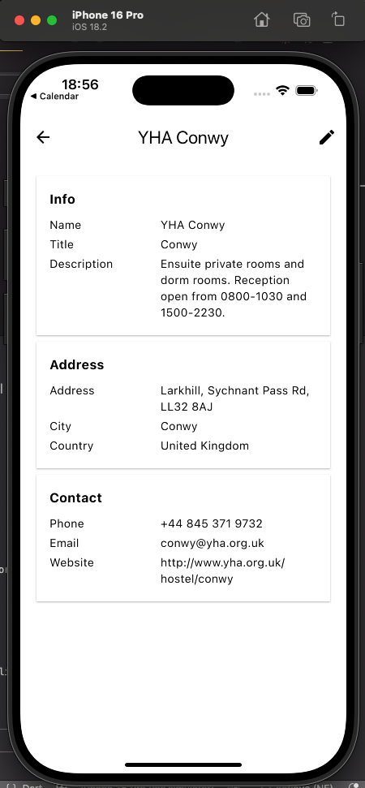
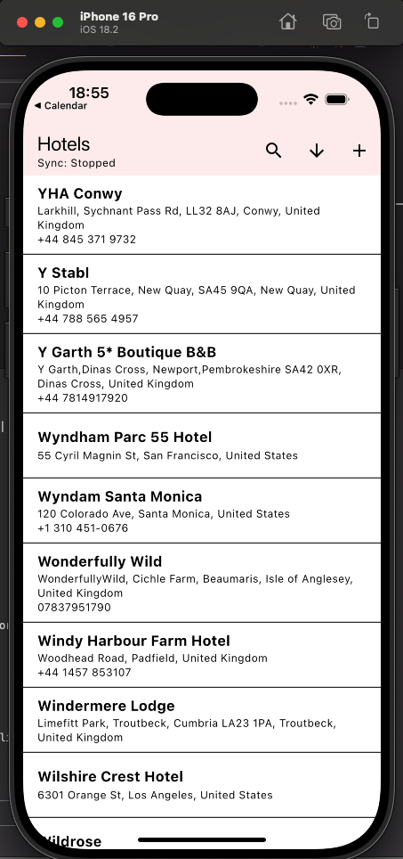
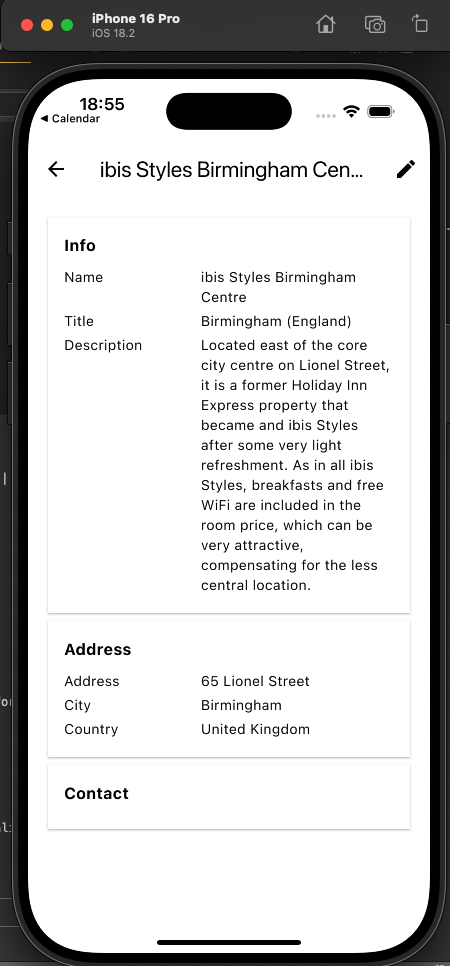

# Hotel Management Quick Start App using Couchbase Lite Flutter SDK + Flutter Material 3 + Capella App Services

> **Note:** Please refer to the [global README.md](../README.md) for the Introduction and Capella Setup instructions before proceeding.

## App Overview
This Flutter sample app demonstrates how to build a simple offline-first application using Flutter Material 3, Couchbase Lite, and Capella App Services — the fully managed version of Sync Gateway and Couchbase Server. The app presents a basic hotel listing interface powered by data from the `travel-sample` dataset, which is hosted in Couchbase Capella and synced locally to the device.

The project serves as a quickstart for developers building Flutter apps that require embedded database functionality with support for local reads/writes, flexible querying, and real-time synchronization with the cloud.

It covers the essentials of:

- Basics of App Services and configuring it for remote sync
- Couchbase Lite database setup and integration using the Flutter SDK
- Performing basic create, read, update, and delete (CRUD) operations
- Basic Query and Full Text Search (FTS)
- Syncing documents from a remote Capella cluster using App Services
- Connecting a Flutter Material 3 interface to local database content

This sample is an ideal example of how developers can build apps that must remain usable without a network connection and synchronize data reliably once connectivity is restored.

## Setup and Technology Stack
- Capella / Capella App Services
- Couchbase Lite Flutter SDK (4.0.0-dev.8)
   - Couchbase Lite Android SDK 4.0.3 (Kotlin)
   - Couchbase Lite iOS SDK 4.0.3 (Swift)
   - Couchbase Lite JavaScript SDK 1.0.0 (Web)
- Flutter Material 3 UI
- MVC Architecture (Model-View-Controller/ViewModel)

## Features
- Offline-first data access with Couchbase Lite
- Flutter Material 3 interface listing hotels from Capella
- Secure data sync using App Services
- Syncs with hotel collection from `travel-sample` dataset
- Basic app user authentication
- Full-Text Search (FTS) for hotel names

## Project Requirements
- Flutter SDK: 3.7+
- Dart SDK: 3.7+
- Android: API 26 (Android 8.0) minimum
- iOS: 13.0+
- UI Framework: Flutter Material 3
- Language: Dart

## Installation Instructions

### Clone this repository
Use the terminal to clone the GitHub repository:

```bash
git clone git@github.com:couchbaselabs/couchbase-mobile-hotel-management-quickstart-app.git
```

### Open the project in your IDE
- Navigate to the `flutter/` folder
- Open in your preferred Flutter IDE (Android Studio, VS Code, etc.)
- Run `flutter pub get`

### Configure the app
Inside the project, locate the config file:

```
flutter/assets/config.json
```

Open the file and provide the following configuration values:

```json
{
    "capellaEndpointUrl": "wss://your-endpoint.apps.cloud.couchbase.com/hotels",
    "username": "your-app-user",
    "password": "your-password"
}
```

- **capellaEndpointUrl** – Paste the "Public URL" from the Connect page of App Services
- **username** – Enter the App User username
- **password** – Enter the App User password

### Caution
If you do not fill out the configuration file, the app **will not sync** with your Capella cluster or endpoint. The app will still work fully offline with a local database.

### Run the app
To run the app:

```bash
cd flutter
flutter run
```

Or select a device/emulator/simulator from your IDE and press Run.

You should see the Hotels Management App launch with the travel-sample hotels list populated after the initial sync completes. Search using FTS is also available as well as creating a new Hotel document.

### Run on Web
```bash
flutter run -d chrome
```

## Architecture

The Flutter app mirrors the Android app's MVC/MVVM architecture:

```
Model Layer:
   - Hotel            : Immutable domain model (mirrors Android Hotel.kt)
   - HotelFormModel    : Mutable form model with copy/toHotel (mirrors HotelFormModel.kt)
   - ConfigurationModel : App config data class
   - ErrorModel        : Error data class

Manager Layer (Controllers):
   - DatabaseManager   : Central Couchbase Lite hub (mirrors DatabaseManager.kt)
   - ConfigurationManager : Loads config.json (mirrors ConfigurationManager.kt)
   - ErrorManager      : Singleton error queue (mirrors ErrorManager.kt)

ViewModel Layer:
   - HotelListViewModel : Bridges list UI and DatabaseManager (mirrors HotelListViewModel.kt)
   - HotelFormViewModel : Bridges form UI and DatabaseManager (mirrors HotelFormViewModel.kt)

View Layer:
   - NavGraph          : Navigation controller (mirrors NavGraph.kt)
   - HotelListScreen   : List with search, sort, swipe actions
   - HotelDetailsScreen : Read-only detail view
   - HotelFormScreen    : Add/edit form
   - QuickstartTheme   : Material 3 theme with Couchbase Red
```

## Try it Out
After running the app successfully, explore the following key features. Each feature is powered by the `DatabaseManager` class and demonstrates how Couchbase Lite enables this offline-first experience.

### Database and Replication Operations
On launch, the app initializes a local Couchbase Lite database and sets up continuous replication with Capella App Services. The `hotel` collection from the `inventory` scope is synced from the remote cluster.

### Document CRUD Operations
You can add, update, and delete hotel documents from the local database.

### Query & Live Query Updates
The app performs flexible queries using SQL++ syntax. A live query listener feeds a Stream that updates the Flutter UI whenever matching data changes.

### Full-Text Search
You can search hotel names using Couchbase Lite's built-in Full Text Search (FTS), enabled via an index on the `name` field.

### Offline-First Sync
Even if you disconnect from the network or Capella App Services goes offline, the app continues working with the local database. Any local changes sync automatically when the connection is restored.

## Screenshots                                                                                                                                          
<p align="center">                                                                                                                                      
                                                                           
                                                                       
                                                                           
</p>   

## Learn more
- [Couchbase Lite on Flutter](https://docs.couchbase.com/couchbase-lite/current/flutter/quickstart.html)
- [App Services](https://docs.couchbase.com/cloud/app-services/index.html)
- [App Services Access Control — Channels](https://docs.couchbase.com/cloud/app-services/channels/channels.html)
- [App Services Access Control & Data Validation](https://docs.couchbase.com/cloud/app-services/deployment/access-control-data-validation.html)
