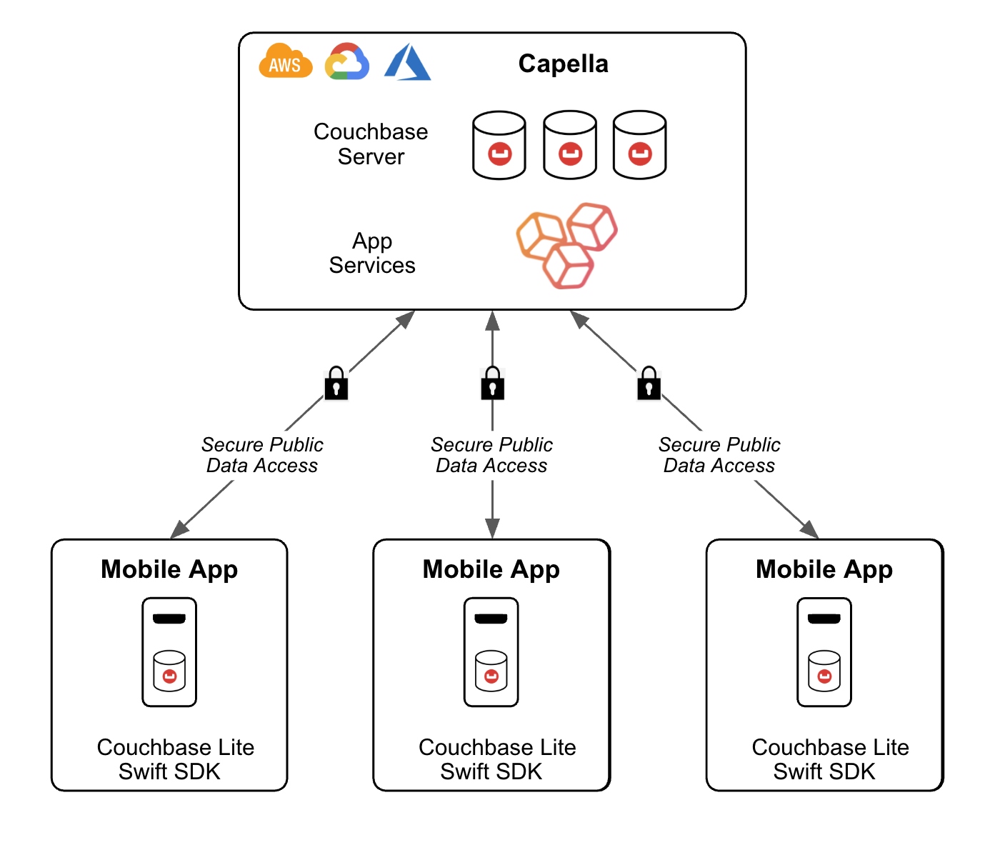
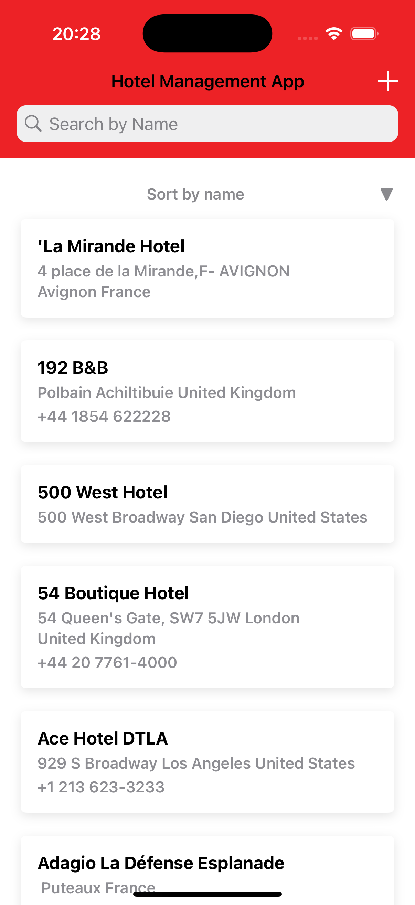

# Hotel Management Quick Start App using Couchbase Lite Swift SDK + Swift UI + Capella App Services

> **Note:** Please refer to the [global README.md](../README.md) for the Introduction and Capella Setup instructions before proceeding.

## App Overview
This iOS sample app demonstrates how to build a simple offline-first SwiftUI application using Couchbase Lite and Capella App Services, fully managed version of Sync gateway and Couchbase Server. The app presents a basic hotel listing interface powered by data from the `travel-sample` dataset, which is hosted in Couchbase Capella and synced locally to the device.

The project serves as a quickstart to developers building mobile apps that require embedded database functionality with support for local reads/writes, flexible querying, and real-time synchronization with the cloud.

It covers the essentials of:

- Basics of App Services and configuring it for remote sync 
- Couchbase Lite database setup and integration on iOS using the Swift SDK  
- Performing basic create, read, update, and delete (CRUD) operations
- Basic Query anf Full Text Search (FTS)
- Syncing documents from a remote Capella cluster using App Services
- Connecting a SwiftUI interface to local database content

This sample is ideal example of how developers can build apps that must remain usable without a network connection and synchronize data reliably once connectivity is restored.

## Setup and Technology Stack


- Capella / Capella App Services
- Couchbase Lite Swift SDK
- Quick Start iOS Swift App

## Features
- Offline-first data access with Couchbase Lite  
- SwiftUI interface listing hotels from Capella  
- Secure data sync using App Services  
- Syncs with hotel collection from `travel-sample` dataset  
- Basic app user authentication  
- Unit and UI tests with XCTest

## Project Requirements
- Xcode: 15.0+  
- iOS: 16+  
- Framework: SwiftUI  
- Dependency Management: Swift Package Manager (SPM)  
- Testing: XCTest (Unit + UI Tests)  
- Database: Couchbase Lite Swift SDK (3.2.1)

## Installation Instructions

### Clone this repository
Use the terminal to clone the GitHub repository:

```bash
git clone https://github.com/couchbase-examples/ios-swift-quickstart.git
```

### Open the project in Xcode
- Navigate to the `ios-swift-quickstart` folder where the repo was closed 
- Open the `ios-swift-quickstart.xcodeproj` file  
  > This should launch Xcode with the project loaded

### Configure the app
Inside the Project Navigator in Xcode:

- Locate the `Config.plist` file inside the `ios-swift-quickstart` folder
- Open the file and provide the following configuration values:

  - **Remote Capella endpoint URL** – Paste the "Public URL" from the Connect page of App Services (discussed earlier)
  - **Authentication / Username** – Enter the App User username  
  - **Authentication / Password** – Enter the App User password

### Caution
If you do not fill out the configuration file, the app **will not sync** with your Capella cluster or endpoint.

### Run the app
To run the app:

- In Xcode, select the device or simulator you'd like to use  
  *(Top bar → change “Any iOS Device” to a listed simulator)*  
- Click the **Run** button or press `Cmd + R`

You should see the Hotels Management App show up in an emulator with the travel-sample hotels list populated.



### Warning
Before running the app, make sure that **Swift Package Manager** has finished downloading the Couchbase SDK.

- In the Project Navigator, scroll to the **Package Dependencies** section  
- If you see a spinner icon next to the dependency, it’s still loading  
- Wait for it to finish before launching the app

### Try it Out
After running the app successfully, explore the following key features. Each feature below is supported by code inside the `DatabaseManager.swift` class and demonstrates how Couchbase Lite powers this offline-first experience.

#### Database and Replication Operations
**Description**:  
On launch, the app initializes a local Couchbase Lite database and sets up continuous replication with Capella App Services. The `hotel` collection from the `inventory` scope is synced down from the remote cluster.

```swift
database = try Database(name: "travel-sample")
collection = try database?.createCollection(name: "hotel", scope: "inventory")

...

let targetEndpoint = URLEndpoint(url: configuration.capellaEndpointURL)
var replConfig = ReplicatorConfiguration(target: targetEndpoint)
replConfig.continuous = true
replConfig.authenticator = BasicAuthenticator(username: configuration.username, password: configuration.password)
replConfig.addCollection(collection)
replicator = Replicator(config: replConfig)
replicator?.start()
```

Learn more:  
- [Database Initialization](https://docs.couchbase.com/couchbase-lite/current/swift/database.html#open-db)  
- [Replication](https://docs.couchbase.com/couchbase-lite/current/swift/replication.html)

#### Document CRUD Operations
**Description**:  
You can add, update, and delete hotel documents from the local database using simple methods.

**Add a hotel document:**
```swift
let doc = MutableDocument()
let encodedHotel = try JSONEncoder().encode(hotel)
let jsonString = String(data: encodedHotel, encoding: .utf8)!
try doc.setJSON(jsonString)
try collection.save(document: doc)
```

**Update a hotel document:**
```swift
let query = try database?.createQuery("SELECT META().id FROM inventory.hotel WHERE type = 'hotel' AND id = \(hotel.id)")
let results = try query?.execute()
for result in results {
    let docid = result.toDictionary()["id"] as? String
    let doc = try collection.document(id: docid!)
    let mutableDoc = doc?.toMutable()
    let jsonString = String(data: try JSONEncoder().encode(hotel), encoding: .utf8)!
    try mutableDoc?.setJSON(jsonString)
    try collection.save(document: mutableDoc!)
}
```

**Delete a hotel document:**
```swift
let query = try database?.createQuery("SELECT META().id FROM inventory.hotel WHERE type = 'hotel' AND id = \(hotel.id)")
let results = try query?.execute()
for result in results {
    let docid = result.toDictionary()["id"] as? String
    let doc = try collection.document(id: docid!)
    try collection.delete(document: doc!)
}
```

Learn more: [Working with Documents](https://docs.couchbase.com/couchbase-lite/current/swift/document.html)

#### Query & Live Query Updates
**Description**:  
The app performs flexible queries using SQL-like syntax (N1QL). A live query listener updates the UI whenever matching data changes in real time.

```swift
let query = try database?.createQuery("SELECT * FROM inventory.hotel WHERE type = 'hotel' ORDER BY name ASC")
lastQueryToken = query?.addChangeListener { change in
    guard let results = change.results else { return }
    var hotels: [Hotel] = []
    for result in results {
        let hotelDoc = try? JSONDecoder().decode(hotelDocumentModel.self, from: Data(result.toJSON().utf8))
        if let hotel = hotelDoc?.hotel {
            hotels.append(hotel)
        }
    }
    self.queryUpdatesSubject.send(hotels)
}
```

Learn more:  
- [SQL++ Queries](https://docs.couchbase.com/couchbase-lite/current/swift/query-n1ql-mobile.html)  
- [Live Queries](https://docs.couchbase.com/couchbase-lite/current/swift/query-live.html)

---

#### Full-Text Search
**Description**:  
You can search hotel names using Couchbase Lite’s built-in Full Text Search (FTS). This is enabled via an index created on the `name` field.

**Index creation:**
```swift
let indexConfig = FullTextIndexConfiguration(["name"], language: "en")
try collection?.createIndex(withName: "hotelNameIndex", config: indexConfig)
```

**Search query:**
```swift
let query = try database?.createQuery("SELECT * FROM inventory.hotel WHERE MATCH(hotelNameIndex, '\(textSearch!)') AND type = 'hotel'")
```

Learn more: [Full Text Search](https://docs.couchbase.com/couchbase-lite/current/swift/fts.html)

#### Offline-First Sync
**Description**:  
Even if you disconnect from the network or Capella App Services go offline, the app continues working with the local database. Any local changes will sync automatically when the connection is restored.

**Try this:**

1. Disable your network or pause the Capella App Endpoint.
2. Add, edit, or delete a hotel in the app.
3. Reconnect to the network and watch the changes sync automatically.
4. Or — try modifying a document in the Capella UI and see it show up in the app.

Learn more: [Offline-First Architecture](https://www.couchbase.com/blog/couchbase-offline-first-app-use-cases/)

## Learn more

To learn more about Couchbase Lite and the Capacitor plugin, look at the following resources:
- [Couchbase lite on swift](#https://docs.couchbase.com/couchbase-lite/current/swift/quickstart.html)
- [App Services](https://docs.couchbase.com/cloud/app-services/index.html)
- [App Services Access Control Concepts- Channels](https://docs.couchbase.com/cloud/app-services/channels/channels.html)
- [App Services Access Control Concepts- Access Control & Data Validation](https://docs.couchbase.com/cloud/app-services/deployment/access-control-data-validation.html)